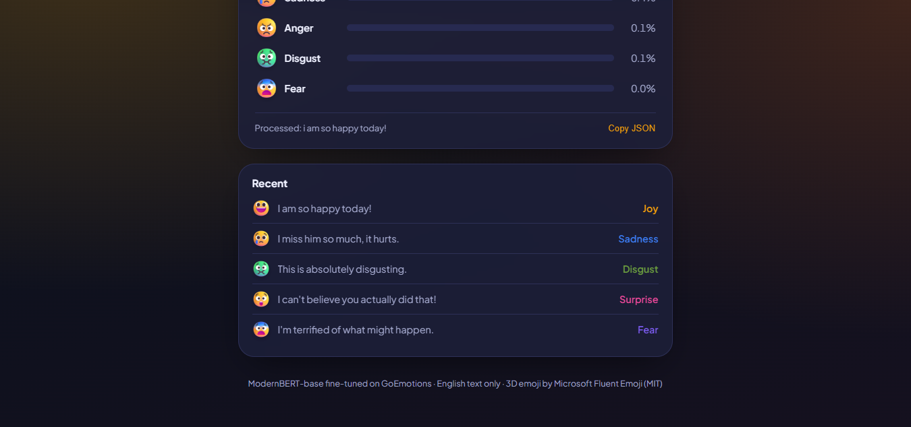

# Emotion Classification on GoEmotions: From Baselines to ModernBERT

An end-to-end Natural Language Processing (NLP) pipeline for classifying text comments into core emotion categories (**anger, disgust, fear, joy, sadness, surprise**) using the [GoEmotions](https://huggingface.co/datasets/google-research-datasets/go_emotions) dataset. This repository covers the complete workflow: from exploratory data analysis and traditional machine learning baselines to deep recurrent neural networks (GRU, LSTM, BiLSTM with custom label-wise attention) and state-of-the-art Transformer fine-tuning using [ModernBERT-base](https://huggingface.co/answerdotai/ModernBERT-base).

The best model is deployed as a **FastAPI** service with a web interface, so you can try it on any sentence.

**Model on Hugging Face:** [Samira-Hassan/modernbert-goemotions-6class](https://huggingface.co/Samira-Hassan/modernbert-goemotions-6class)

---

## Demo

<!--
  🎬 DEMO VIDEO: put your screen recording here.

  Option A (recommended): edit this README on github.com, drag your .mp4 into the editor,
  and GitHub will insert a link that plays inline. Paste that link on its own line below.

  Option B: convert the recording to a GIF (under about 10 MB), save it as assets/demo.gif,
  and use:  
-->

> 🎬 **Demo video goes here.**

---

## Screenshots

<!--
  📸 Save your screenshots in assets/screenshots/ with the names below
  (or change the paths). Delete any row you don't use.
-->

| Home | Result |
|---|---|
|  |  |

| Recent history | API docs (Swagger) |
|---|---|
|  |  |

---

## Features

- Six-emotion classification with a probability for every class.
- Web interface with 3D emoji, animated probability bars and a history of recent analyses.
- REST API with single and batch prediction, plus interactive docs at `/docs`.
- Text cleaning identical to the preprocessing used in training (HTML, URLs, emails, mentions, emoji).
- Runs on CPU or GPU, and ships with a Dockerfile.

## 🏗️ Model Progression & Architecture Benchmark

The project started from a classic baseline and moved through recurrent and attention-based architectures before settling on a Transformer.

| Model | Architecture Type | Test Accuracy | Macro F1-Score |
| :--- | :--- | :---: | :---: |
| **TF-IDF + Logistic Regression** | Baseline | 55.01% | 0.53 |
| **GRU + FastText 300d** | RNN | 52.81% | 0.51 |
| **LSTM + FastText 300d** | RNN | 54.68% | 0.52 |
| **BiLSTM + FastText 300d** | Bidirectional RNN | 54.82% | 0.52 |
| **BiLSTM + Label-Wise Attention** | Custom Attention | 57.41% | 0.55 |
| 🏆 **ModernBERT-base** | **Transformer** | **Best Performing** | **Optimized** |

<!--
  ✏️ Replace "Best Performing" and "Optimized" in the last row with the real
  ModernBERT test accuracy and macro F1, for example: **XX.XX%** and **0.XX**.
-->

**Takeaways**

- The TF-IDF + Logistic Regression baseline (55.01%) was hard to beat: plain GRU, LSTM and BiLSTM models with FastText embeddings did not improve on it.
- Adding label-wise attention to the BiLSTM gave the largest gain among the non-Transformer models (about +2.6 points of accuracy over the plain BiLSTM).
- The fine-tuned ModernBERT-base model is the best performer and is the one served by this API.

## Emotion classes

| Label | Meaning |
|---|---|
| `anger` | Annoyance, rage, irritation |
| `disgust` | Revulsion, distaste |
| `fear` | Anxiety, worry, terror |
| `joy` | Happiness, amusement, excitement |
| `sadness` | Grief, disappointment, sorrow |
| `surprise` | Astonishment, shock |

## Quick start

### Run locally

```bash
git clone https://github.com/YOUR-GITHUB-USERNAME/emotion-api.git
cd emotion-api

python -m venv venv
# Windows: venv\Scripts\activate    macOS/Linux: source venv/bin/activate

pip install -r requirements.txt
uvicorn app:app --host 0.0.0.0 --port 8000
```

Open <http://localhost:8000> for the interface or <http://localhost:8000/docs> for the API docs.
The model is downloaded from the Hugging Face Hub the first time the server starts.

To use a different model or a local folder:

```bash
# Windows PowerShell
$env:MODEL_ID="D:\ModernBERT_GoEmotions"; uvicorn app:app --port 8000

# macOS/Linux
MODEL_ID=/path/to/model uvicorn app:app --port 8000
```

### Run with Docker

```bash
docker build -t emotion-api .
docker run -p 8000:8000 emotion-api
```

## API

### `POST /predict`

```bash
curl -X POST http://localhost:8000/predict \
  -H "Content-Type: application/json" \
  -d '{"text": "I am so happy today!"}'
```

Example response (values are illustrative):

```json
{
  "original_text": "I am so happy today!",
  "cleaned_text": "i am so happy today!",
  "predicted_emotion": "joy",
  "confidence": 0.97,
  "probabilities": {
    "anger": 0.004,
    "disgust": 0.002,
    "fear": 0.003,
    "joy": 0.97,
    "sadness": 0.01,
    "surprise": 0.011
  }
}
```

### `POST /predict/batch`

Send up to 64 texts at once:

```bash
curl -X POST http://localhost:8000/predict/batch \
  -H "Content-Type: application/json" \
  -d '{"texts": ["I love this!", "This is disgusting."]}'
```

### `GET /health`

Returns the server status, the model id, the device in use and the class labels.

## Project structure

```
emotion-api/
├── app.py              # FastAPI app: model loading, text cleaning, endpoints
├── index.html          # Web interface (served at /)
├── requirements.txt
├── Dockerfile
├── .dockerignore
├── .gitignore
├── README.md
├── notebooks/          # EDA, baselines, RNNs and ModernBERT fine-tuning (add yours)
└── assets/
    ├── demo.mp4 / demo.gif        # demo recording (add yours)
    └── screenshots/               # interface screenshots (add yours)
        ├── 01-home.png
        ├── 02-result.png
        ├── 03-history.png
        └── 04-swagger.png
```

## Model details

| | |
|---|---|
| Base model | `answerdotai/ModernBERT-base` |
| Task | Single-label text classification, 6 classes |
| Dataset | GoEmotions (Reddit comments) |
| Max sequence length | 128 tokens |
| Language | English |

See the benchmark above for how it compares with the earlier models. Training details, evaluation results and the label mapping are documented in the
[model card](https://huggingface.co/Samira-Hassan/modernbert-goemotions-6class).

## Limitations

- English only. Other languages give unreliable results.
- Only six emotions are predicted, so mixed or neutral text is still assigned to one of them.
- The model was trained on Reddit comments, and accuracy may drop on very different text such as formal writing.
- Sarcasm and irony are hard for the model.
- Do not use it as the sole basis for decisions that affect people.

## Acknowledgments

- [ModernBERT](https://huggingface.co/answerdotai/ModernBERT-base) by Answer.AI and LightOn.
- [GoEmotions](https://huggingface.co/datasets/google-research-datasets/go_emotions) by Google Research.
- 3D emoji from [Microsoft Fluent Emoji](https://github.com/microsoft/fluentui-emoji) (MIT License).

## License

Released under the Apache 2.0 license. <!-- Add a LICENSE file to the repo root (GitHub: Add file > Create new file > LICENSE > choose a template). -->
