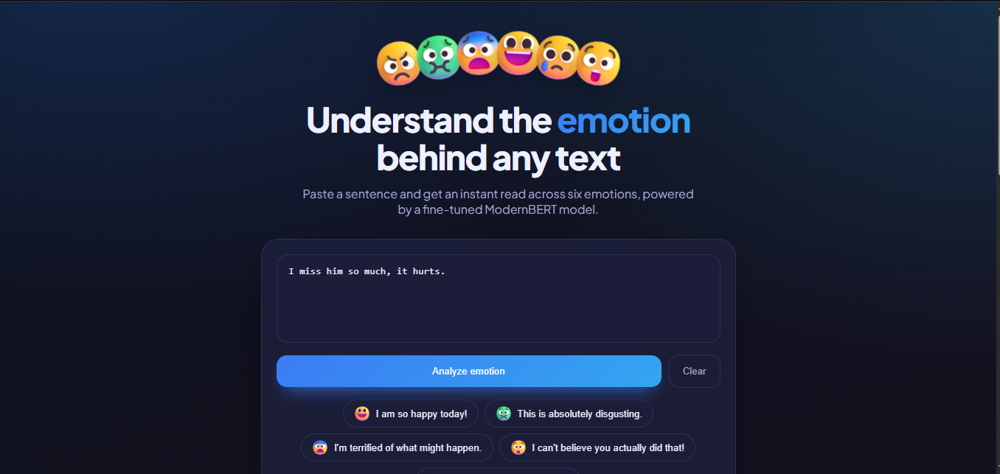
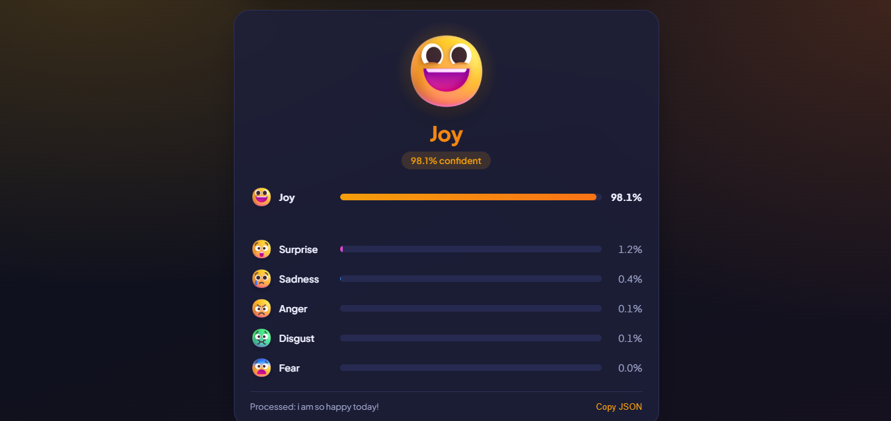

# Emotion Classification on GoEmotions: From Baselines to ModernBERT

An end-to-end Natural Language Processing (NLP) pipeline for classifying text comments into core emotion categories (**anger, disgust, fear, joy, sadness, surprise**) using the [GoEmotions](https://huggingface.co/datasets/google-research-datasets/go_emotions) dataset. This repository covers the complete workflow: from exploratory data analysis and traditional machine learning baselines to deep recurrent neural networks (GRU, LSTM, BiLSTM with custom label-wise attention) and state-of-the-art Transformer fine-tuning using [ModernBERT-base](https://huggingface.co/answerdotai/ModernBERT-base).

The project has two parts:

1. **Research** in a [public Kaggle notebook](https://www.kaggle.com/code/samoura/multi-class-emotion-classification-on-goemotion): data analysis, every model that was tried, and the final fine-tuning.
2. **Deployment** in `app.py` and `index.html`: the best model served as a **FastAPI** API with a web interface, so you can try it on any sentence.

**Model on Hugging Face:** [Samira-Hassan/modernbert-goemotions-6class](https://huggingface.co/Samira-Hassan/modernbert-goemotions-6class)

---

## 📓 Notebook

The full research workflow lives in a single public notebook on Kaggle.

[](https://www.kaggle.com/code/samoura/multi-class-emotion-classification-on-goemotion)

**[🎭 Multi-Class Emotion Classification on GoEmotion](https://www.kaggle.com/code/samoura/multi-class-emotion-classification-on-goemotion)**

| Stage | Model | Test accuracy |
| :--- | :--- | :---: |
| Baseline | TF-IDF + Logistic Regression | 55.01% |
| Recurrent networks | GRU / LSTM / BiLSTM + FastText 300d | 52.81% / 54.68% / 54.82% |
| Custom attention | BiLSTM + Label-Wise Attention | 57.41% |
| Transformer | ModernBERT-base fine-tuning | 58.91% |

The notebook goes from exploratory data analysis and text cleaning, through each model above, to the final ModernBERT fine-tuning whose weights are served by this API.
The FastText models use the pre-trained `crawl-300d-2M-subword` embeddings, which are attached to the Kaggle notebook as a data source.

## 🏗️ Model Progression & Architecture Benchmark

The project started from a classic baseline and moved through recurrent and attention-based architectures before settling on a Transformer. All models are evaluated on the test set and ranked by Macro F1.

### Overall Model Ranking & Performance Metrics

| Rank | Model Architecture | Type | Accuracy | Macro Precision | Macro Recall | Macro F1 | Weighted F1 |
| :-: | :--- | :--- | :---: | :---: | :---: | :---: | :---: |
| 1 | 🏆 **ModernBERT-base** | Transformer | **0.5891** | **0.5758** | **0.5636** | **0.5680** | **0.5924** |
| 2 | BiLSTM + Label-Wise Attention | Custom Attention | 0.5741 | 0.5544 | 0.5525 | 0.5527 | 0.5738 |
| 3 | TF-IDF + Logistic Regression | Baseline | 0.5501 | 0.5266 | 0.5333 | 0.5292 | 0.5514 |
| 4 | LSTM | RNN | 0.5468 | 0.5315 | 0.5279 | 0.5210 | 0.5449 |
| 5 | BiLSTM | Bidirectional RNN | 0.5482 | 0.5375 | 0.5247 | 0.5204 | 0.5484 |
| 6 | GRU | RNN | 0.5281 | 0.5083 | 0.5165 | 0.5082 | 0.5307 |

**Takeaways**

- **ModernBERT-base is the best model on every metric**: it improves Macro F1 by about 0.015 over the best non-Transformer model and by about 0.039 over the TF-IDF baseline.
- **Label-wise attention made the biggest difference among the recurrent models**: it lifted the BiLSTM from 0.5204 to 0.5527 Macro F1 (and from 0.5482 to 0.5741 accuracy).
- **The TF-IDF baseline is strong**: plain GRU, LSTM and BiLSTM models scored below it on both accuracy and Macro F1.
- The fine-tuned ModernBERT-base model is the one served by this API.

---
## 🎬 Application Demo

**▶️ [Watch the Local Deployment Demo](assets/demo.mp4)**
---

## Screenshots

| Home 
|---|
|  |

| Result | Recent history 
|---|---|
|  |  | 
---

## Features

- Six-emotion classification with a probability for every class.
- Web interface with 3D emoji, animated probability bars and a history of recent analyses.
- REST API with single and batch prediction, plus interactive docs at `/docs`.
- Text cleaning identical to the preprocessing used in training (HTML, URLs, emails, mentions, emoji).
- Runs on CPU or GPU, and ships with a Dockerfile.

## Emotion classes

| Label | Meaning |
|---|---|
| `anger` | Annoyance, rage, irritation |
| `disgust` | Revulsion, distaste |
| `fear` | Anxiety, worry, terror |
| `joy` | Happiness, amusement, excitement |
| `sadness` | Grief, disappointment, sorrow |
| `surprise` | Astonishment, shock |

## Quick start

### Run locally

```bash
git clone https://github.com/Samira-Hassann/Emotion-Analyzer.git
cd Emotion-Analyzer

python -m venv venv
# Windows: venv\Scripts\activate    macOS/Linux: source venv/bin/activate

pip install -r requirements.txt
uvicorn app:app --host 0.0.0.0 --port 8000
```

Open <http://localhost:8000> for the interface or <http://localhost:8000/docs> for the API docs.
The model is downloaded from the Hugging Face Hub the first time the server starts.

To use a different model or a local folder:

```bash
# Windows PowerShell
$env:MODEL_ID="D:\ModernBERT_GoEmotions"; uvicorn app:app --port 8000

# macOS/Linux
MODEL_ID=/path/to/model uvicorn app:app --port 8000
```

### Run with Docker

```bash
docker build -t emotion-analyzer .
docker run -p 8000:8000 emotion-analyzer
```

## API

### `POST /predict`

```bash
curl -X POST http://localhost:8000/predict \
  -H "Content-Type: application/json" \
  -d '{"text": "I am so happy today!"}'
```

Example response (values are illustrative):

```json
{
  "original_text": "I am so happy today!",
  "cleaned_text": "i am so happy today!",
  "predicted_emotion": "joy",
  "confidence": 0.97,
  "probabilities": {
    "anger": 0.004,
    "disgust": 0.002,
    "fear": 0.003,
    "joy": 0.97,
    "sadness": 0.01,
    "surprise": 0.011
  }
}
```

### `POST /predict/batch`

Send up to 64 texts at once:

```bash
curl -X POST http://localhost:8000/predict/batch \
  -H "Content-Type: application/json" \
  -d '{"texts": ["I love this!", "This is disgusting."]}'
```

### `GET /health`

Returns the server status, the model id, the device in use and the class labels.

## Project structure

```
emotion-api/
├── app.py              # FastAPI app: model loading, text cleaning, endpoints
├── index.html          # Web interface 
├── requirements.txt
├── Dockerfile
├── .dockerignore
├── .gitignore
├── README.md
└── assets/
    ├── demo.mp4   # demo recording
    └── screenshots/               # interface screenshots 
        ├── 01-home.png
        ├── 02-result.png
        └── 03-history.png
```

## Model details

| | |
|---|---|
| Base model | `answerdotai/ModernBERT-base` |
| Task | Single-label text classification, 6 classes |
| Dataset | GoEmotions (Reddit comments) |
| Max sequence length | 128 tokens |
| Language | English |

See the benchmark above for how it compares with the earlier models. Training details, evaluation results and the label mapping are documented in the
[model card](https://huggingface.co/Samira-Hassan/modernbert-goemotions-6class).

## Limitations

- Overall test accuracy is about 59% on this six-class task, so treat predictions as a useful signal and not as ground truth.
- English only. Other languages give unreliable results.
- Only six emotions are predicted, so mixed or neutral text is still assigned to one of them.
- The model was trained on Reddit comments, and accuracy may drop on very different text such as formal writing.
- Sarcasm and irony are hard for the model.
- Do not use it as the sole basis for decisions that affect people.

## Acknowledgments

- [ModernBERT](https://huggingface.co/answerdotai/ModernBERT-base) by Answer.AI and LightOn.
- [GoEmotions](https://huggingface.co/datasets/google-research-datasets/go_emotions) by Google Research.
- 3D emoji from [Microsoft Fluent Emoji](https://github.com/microsoft/fluentui-emoji) (MIT License).

## License

Released under the Apache 2.0 license. 
